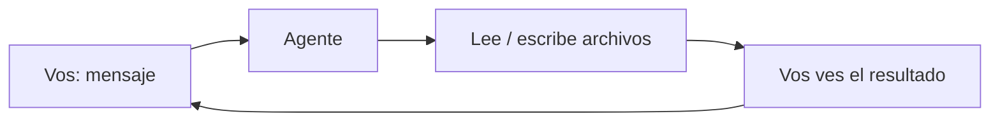

# 🧭 Nivel 01 — Fundamentos

> ⚠️ ¿Llegaste directo a este archivo, sin pasar por `INSTRUCCIONES-AGENTE.md` (raíz del repo) ni por el Nivel 00? Primero confirmá que estás usando un **agente de código** (Claude Code, Codex CLI, etc.) y no un chat común (ChatGPT/Claude/Gemini en el navegador) — esos no pueden hacer lo que sigue. Y si todavía no le contaste a tu agente quién sos y para qué querés esto, volvé a [Nivel 00 — Contexto](00-contexto.md), va primero.

## Qué es esto

Un agente de código es distinto de un chat común: además de contestarte, puede **leer y escribir archivos de verdad en tu computadora** — dentro de la carpeta donde lo abriste, nada más. Todo lo que vas a construir en los próximos niveles (memoria, base de conocimiento, tu forma de trabajar) no es ninguna configuración escondida ni magia: son archivos de texto simples, que podés abrir y leer vos mismo/a cuando quieras, y que vos y tu agente van completando juntos.



Este círculo se repite todo el tiempo: vos pedís algo, el agente toca un archivo real, y vos ves el resultado en la pantalla. Todo lo que sigue en esta guía es, en el fondo, una variación de este mismo círculo.

## ⚠️ No perder tu carpeta — esto es más importante de lo que parece

Todo lo que vas a construir queda guardado DENTRO de la carpeta que elegiste para esto — no "en la nube", no "en tu cuenta", en esta carpeta puntual de tu computadora. Si la próxima vez abrís tu agente en una carpeta distinta (aunque sea sin darte cuenta), el agente no va a ver nada de lo que hicieron juntos — va a parecer que "se olvidó de todo", pero en realidad está mirando un lugar equivocado.

**Hacé esto ahora, antes de seguir:**

1. Fijate el nombre completo de esta carpeta y dónde está (pedile a tu agente que te diga la ruta completa si no la sabés).
2. Guardá esa información en algún lugar que vayas a encontrar de nuevo (una nota en el celular, un papel, lo que sea) — algo así como "mi carpeta del agente está en [ruta]".
3. La próxima vez que quieras seguir, abrí tu agente EN ESA MISMA carpeta — no en una nueva, no en el escritorio, no en "Documentos" en general.

Si en algún momento no estás seguro de si estás en la carpeta correcta: buscá en tu computadora (con el buscador de archivos de tu sistema) un archivo llamado `quien-soy.md` — cuando exista (después del Nivel 00), la carpeta donde aparezca es la correcta.

## Antes de seguir

Confirmá que tu agente puede de verdad leer y escribir en esta carpeta. Es un chequeo de 30 segundos, pero si falla acá, nada de lo que sigue va a funcionar.

Aprovechamos el mismo momento para anotar dos datos más que vamos a necesitar más adelante — así no hay que volver a preguntarlos después:

- **En qué sistema operativo estás** (Windows, Mac o Linux — el tipo de computadora que usás).
- **Si tu agente puede ejecutar un comando de terminal.** La terminal es una ventanita de texto donde le das órdenes a la computadora escribiéndolas, en vez de hacer clicks. No todos los agentes pueden usarla: algunos solo tocan archivos, otros también saben escribir en la terminal. Ninguna de las dos es mejor — solo necesitamos saber cuál es la tuya, porque más adelante va a importar.

## Checkpoint

Estas cinco cosas tienen que pasar, en este orden:

1. El agente crea el archivo.
2. Te dice la ruta completa de la carpeta, para que la anotes.
3. Te confirma tu sistema operativo.
4. Corre un comando de solo lectura sin problemas (o te avisa con claridad si no puede hacerlo — no es grave, es solo información).
5. Cuando le pedís que te diga qué dice el archivo, te repite el contenido correcto — el que él mismo escribió, no algo inventado.

**Prueba:** vos abrís `hola.md` en esa ruta y ves lo mismo que te dijo tu agente: la línea "Primer contacto", tu sistema operativo y si puede usar la terminal. El chequeo de estado no mira este nivel: la prueba es el archivo.

---

> [!TIP]
> 🧭 **Decile esto a tu agente:**
>
> ```
> Creá un archivo llamado hola.md en esta carpeta, con el texto
> "Primer contacto: [fecha de hoy]". Después leelo y decime qué
> dice. Decime también la ruta completa de esta carpeta, para
> poder anotarla.
>
> Además, confirmame dos cosas más: en qué sistema operativo estoy
> (Windows, Mac o Linux), y si podés ejecutar un comando de
> terminal de solo lectura (por ejemplo, revisar si tengo git
> instalado y qué versión, sin instalar ni cambiar nada). Si no
> podés ejecutar comandos, decímelo así de simple, no es un
> problema todavía. Agregá las dos respuestas a hola.md, abajo del
> texto que ya pusiste.
> ```
